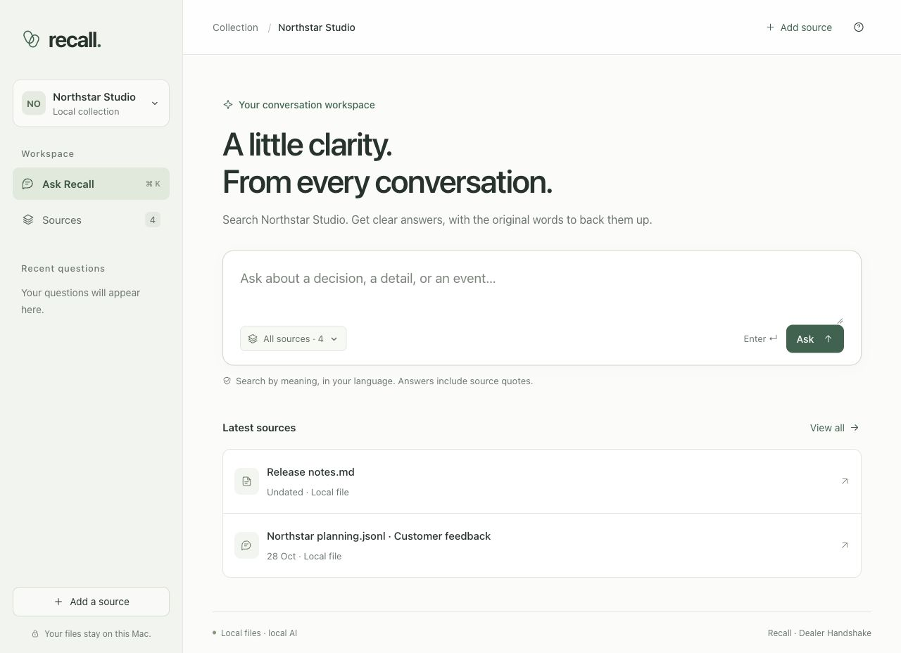
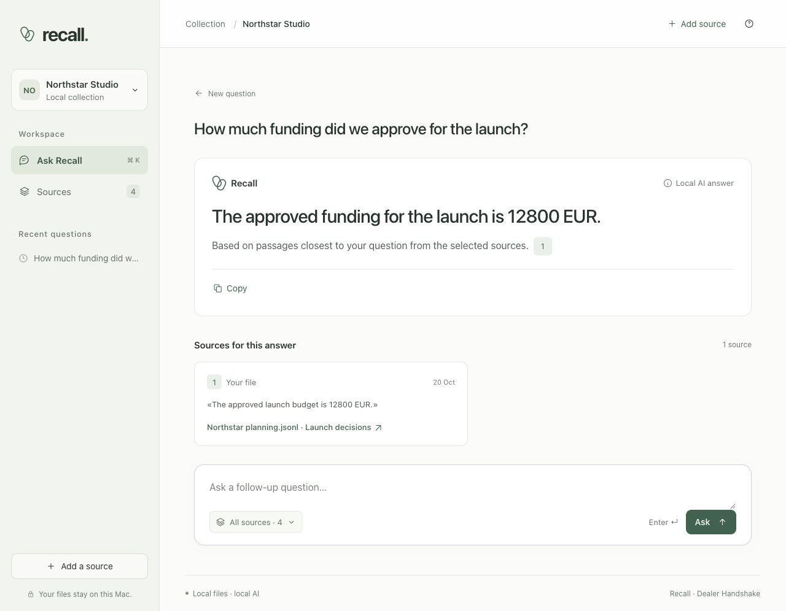
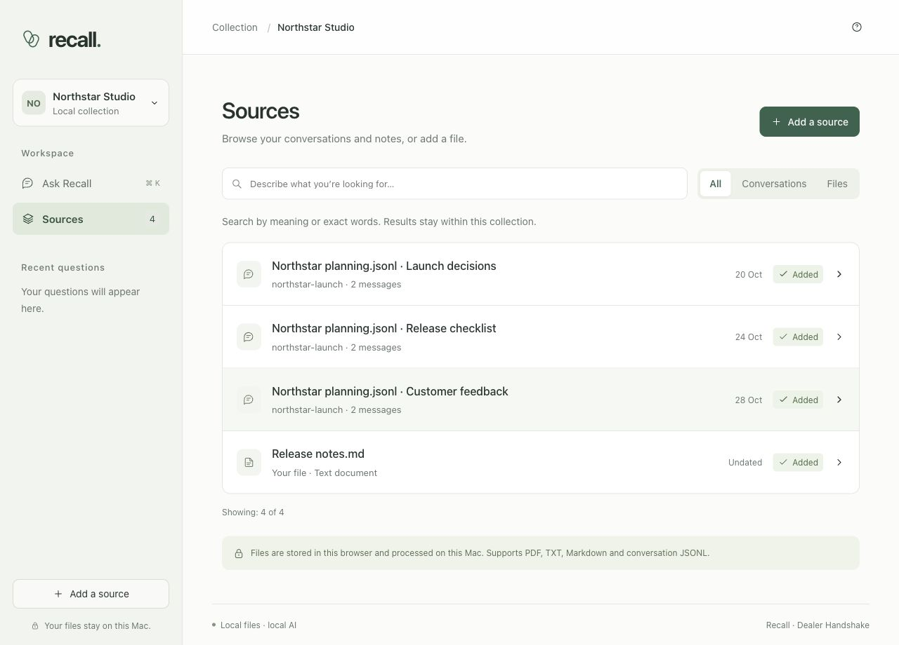
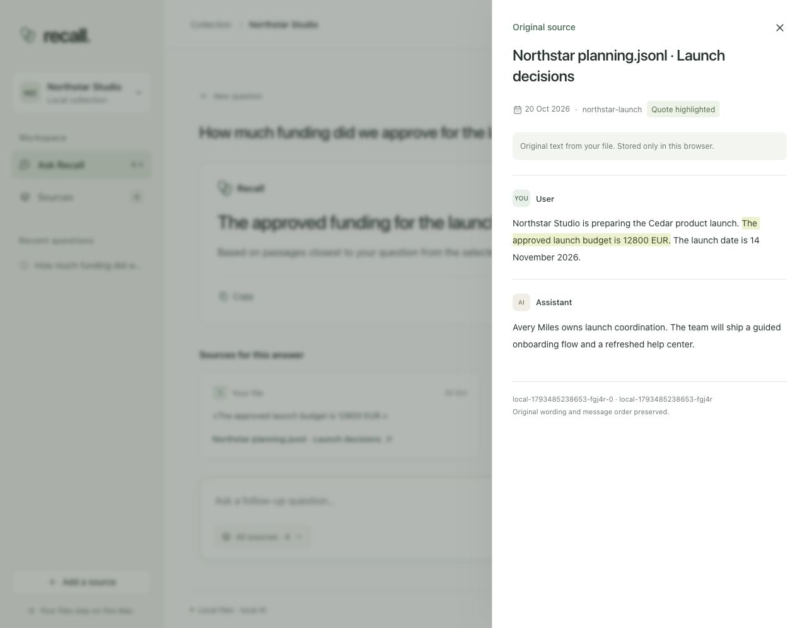

# Recall

**Memory you can trace.**

Find answers in your conversations and documents, then open the original words behind them. Recall runs locally and searches by meaning, so questions can use different wording or a different language from the source.



*All screenshots use fictional English data created for this documentation. No personal documents or user history are shown.*

## What you can do

- **Ask naturally.** Search by meaning, follow up on a question, or look up an exact word, code or amount.
- **Check the evidence.** Open a citation to see the original passage and surrounding messages. PDF citations retain page numbers.
- **Keep projects separate.** Create collections, select sources and limit questions to a date.
- **Bring your own files.** Import PDF, TXT, Markdown and structured conversation JSONL.

The interface has two working areas: **Ask Recall** and **Sources**. Answers and embeddings are generated by local models; no cloud model account or API key is needed.

## Screenshots

### Ask in your own words

The question asks about “funding”; the source calls it the “approved launch budget.” Recall finds the relevant passage and attaches its original quote.



### Browse your sources

Search within the active collection and filter conversations or files.



### Read the original

Open a citation to inspect the highlighted passage in context.



The [screenshot notes and fixtures](docs/README.md) explain how to reproduce these views.

## Run locally

You need **Python 3**, **Node.js/npm**, **Ollama** and a modern browser. Install and start Ollama first. If it is not already running, start it in a separate terminal:

```sh
OLLAMA_NO_CLOUD=1 ollama serve
```

From the repository root:

```sh
npm run dev
```

The launcher creates a Python environment, installs the PDF dependency and downloads missing local models: `qwen3:4b-instruct` and `qwen3-embedding:4b`. The first setup needs internet access and several gigabytes of disk space. Open the local address printed by the server.

See the [setup and implementation guide](app/local/README.md) for configuration, retrieval details and checks.

## Add your files

1. Open the collection selector and choose **Create a collection**.
2. Choose **Add a source** and import a file.
3. Ask a question, then open its citations to verify the answer.

| Format | Supported content | Limit |
| --- | --- | --- |
| PDF | Selectable text, with original page numbers | 10 MB, 200 pages, 1 million extracted characters |
| TXT / Markdown | Plain-text notes and documents | 1 MB per file |
| JSONL | Conversations with dates, speaker roles and messages | 1 MB, 100 conversations per import |

Scans need OCR beforehand. Password-protected PDFs must be exported unlocked. PDF tables, columns, images and layout may not survive text extraction.

<details>
<summary>Conversation JSONL example</summary>

Each line is one JSON object. A history contains sessions; each session contains turns. Use unique identifiers and ISO dates where available.

```jsonl
{"history_id":"project-notes","sessions":[{"session_id":"launch-planning","date":"2026-10-20","turns":[{"turn_id":"message-1","role":"user","content":"The approved launch budget is 12800 EUR."}]}]}
```

</details>

## Search and answer behavior

Semantic retrieval combines local embeddings with keyword and exact-match signals. Short keyword and amount lookups can return original passages directly. Currency aliases and grouped amounts are normalized for matching; this does not convert currencies.

Follow-up questions use the last three completed questions as context. Starting a new question, changing the collection or filters, opening history, or reloading resets that context. Only the selected source text can support an answer.

Every returned citation is checked against the original source. Whitespace differences from PDF extraction are allowed, but words, numbers, punctuation and currencies must match. If an answer cannot be verified after a retry, Recall discards its claims and shows original passages for review. A verified quote is evidence to inspect, not a guarantee that every generated claim is correct.

## Privacy and limits

Extracted text, collections and recent questions are stored in this browser. The original PDF is not retained. Selected content is processed by the local Python server and Ollama. There is no account sync; keep your original files because clearing browser site data removes imports.

The local embedding cache stores hashes and vectors, not original text. First searches can take longer while files are indexed. Semantic retrieval can miss relevant passages, and local models can make mistakes. DOCX, OCR, automatic fact extraction and timelines are not implemented.

Date filters include dated sources on or before the chosen day. Undated sources are excluded until the filter is cleared. Cancelling stops the UI waiting; a model request already in progress may still finish in the background.

## Checks

From the repository root, after local setup:

```sh
npm test
```

For checks against the running local models:

```sh
npm run test:live
```

These cover imports, filters, search equivalences, retrieval, follow-up questions, citation validation, PDF layout and safe fallback behavior. Live checks use synthetic sources and can vary with the model.

## Research and submission

Built for the Reactive AI Memory Retrieval Challenge, START Warsaw × Poland Tech Week, October 30–31, 2026. The local Ollama application above is separate from the Reactor-backed challenge pipeline.

| Path | Contents |
| --- | --- |
| [Local Recall](app/local/README.md) | Current interface, local semantic search, file imports and source quotes |
| [Reactor application](app/README.md) | Streamlit interface and Reactor setup |
| [Reactor HTTP API](app/API.md) | Existing web interface and API on port 8787 |
| [Pipeline](pipeline/README.md) | Retrieval pipeline, official Reactor client, experiments and tests |
| [Submitted predictions](predictions.jsonl) | Answers, abstentions and citations from the challenge submission |
| [Presentation](idea/deck.pdf) | Latest presentation slides |

### Final submission

The submitted file contains **146 predictions: 131 answers and 15 abstentions**. It includes a wider-retrieval rerun of 15 questions flagged during an audit of the raw histories. These are submission counts, not an accuracy score.

The [final-run report](pipeline/experiments/final-run/RESULT.md) describes the configuration, timing, rerun, and merge rules. Raw Reactor replies are included alongside the report. Predictions are preserved from the final research snapshot of October 31, 2026; the presentation has been corrected to reflect that run and distinguish development results from the unscored test submission.

### Challenge checks

After installing the Reactor application's dependencies:

```sh
.venv-app/bin/python -m pytest -q pipeline/tests
bash app/check_api.sh
```

The API check uses the local mock Reactor. The full challenge datasets are not included.

---

Built by **Dealer Handshake**.
